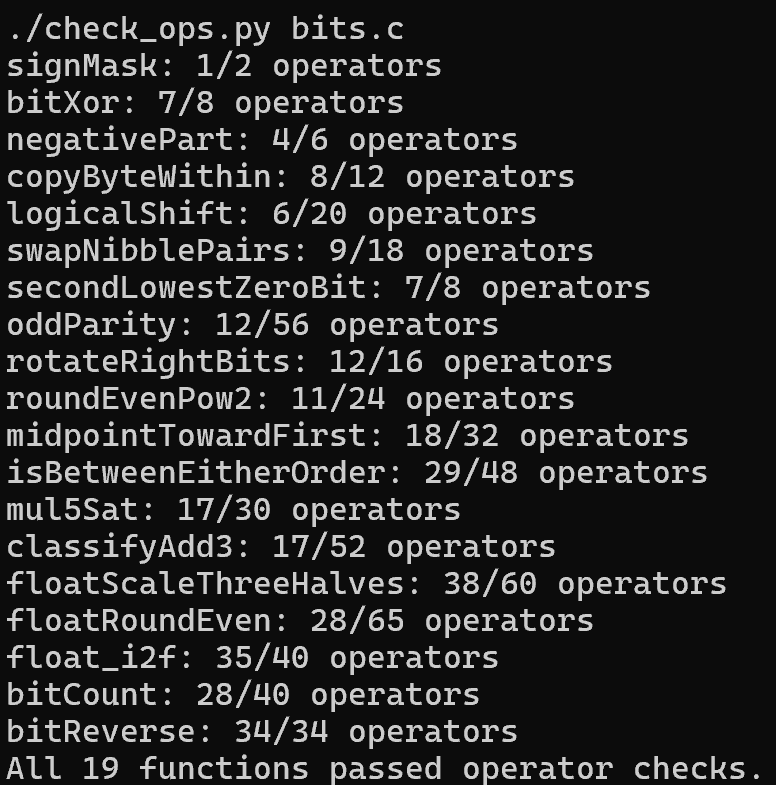
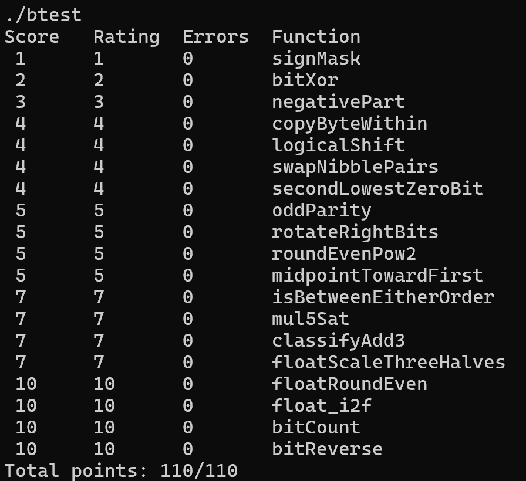

# Lab 1：Data Lab 实验报告

姓名：何东洋

学号：25800740061

实验日期：2026 年 10 月 9 日

## 实验内容

本次实验需要完成 `bits.c` 中的 19 个函数。整数题主要用位运算处理数据，浮点题则需要根据单精度浮点数的编码计算结果。实验在 WSL 的 Ubuntu 环境中编译和测试。

## 各题思路

### P1 signMask

`1` 的二进制只有最低位为 1。把它左移 31 位，就能得到最高位为 1、其余位为 0 的结果。

### P2 bitXor

异或要求两个对应位不同时才得到 1。因为这题只能用 `~` 和 `&`，所以先用 `~(~x & ~y)` 表示至少有一个位为 1，再用 `~(x & y)` 排除两个位都是 1 的情况，最后将两部分按位与。

### P3 negativePart

用 `x >> 31` 判断符号：负数得到全 1，非负数得到全 0。把 `~x + 1` 与这个结果按位与，负数就保留相反数，非负数就变成 0。`INT_MIN` 按题目规定保留低 32 位。

### P4 copyByteWithin

一个字节有 8 位，所以先把字节编号左移 3 位，得到移动的位数。将源字节和目标字节移到低位，异或后取出它们不同的位，再移回目标位置与原数异或，就完成了替换。

### P5 logicalShift

负数直接右移时，高位会补 1，而题目要求补 0。因此先右移，再用掩码清掉高位多出来的 1。当 `n` 为 0 时，掩码是全 1，结果保持原值。

### P6 swapNibblePairs

每个字节的高 4 位和低 4 位需要交换，例如 `0xAB` 变成 `0xBA`。用 `0x0f0f0f0f` 分别取出两部分，一部分左移 4 位，另一部分右移 4 位，再合并。

### P7 secondLowestZeroBit

先将 `x` 取反，这样找第二个 0 就变成了找第二个 1。清除最低的一个 1，再提取新的最低位 1，就得到所需位置。如果原数不足两个 0，结果自然为 0。代码中的减一用加 `~0` 实现，取负用取反加一实现。

### P8 oddParity

用异或逐步合并各部分的奇偶性，右移的位数依次为 16、8、4、2、1。最后最低位就表示 1 的数量是奇数还是偶数。这题要求偶数个 1 时返回 1，所以还要对最低位取逻辑非。例如 `5` 的二进制有两个 1，返回值应为 1。

### P9 rotateRightBits

先用 `n & 31` 得到实际需要循环移动的位数。右移后留下的部分与左移回绕的部分合并，就是循环右移结果。右移部分需要清除符号扩展；左移量也要对 32 取模，避免出现移位 32 位的情况。

### P10 roundEvenPow2

先右移求出商，再根据商的奇偶性设置舍入偏移量：半个间隔减一，再加上商的最低位。这样小于半程时向下舍入，大于半程时向上舍入，正好在中间时选择偶数商。例如间隔为 4 时，10 舍入到 8，14 舍入到 16。

### P11 midpointTowardFirst

直接计算 `x + y` 可能溢出，所以用 `(x & y) + ((x ^ y) >> 1)` 先求向下取整的中点。如果中点带有半个整数，而且 `x` 更大，就将结果加一，使它靠近第一个参数。例如 `(4, 7)` 返回 5，交换参数后返回 6。判断大小时还要区分同号和异号，避免相减溢出。

### P12 isBetweenEitherOrder

分别判断 `x` 是否小于 `a` 和 `b`。两个判断结果不同，说明 `x` 在两端点之间；再加上等于端点的情况，就包含了整个闭区间。这种写法不用先确定哪个端点更大。比较时先看符号，只有同号时才根据差值判断大小。

### P13 mul5Sat

先算两倍、四倍，再把四倍与原数相加，得到五倍。溢出可能发生在中间步骤，所以需要检查这三个结果的符号是否与原数不同。发生溢出时，正数返回 `INT_MAX`，负数返回 `INT_MIN`。

### P14 classifyAdd3

把三个数的求和拆成两次加法，分别记录每次溢出的方向：正溢出记为 1，负溢出记为 -1，没有溢出记为 0。最后把两个记录相加。不能只要中途溢出就判定最终溢出，例如 `INT_MAX + 1 - 1` 的最终结果仍在范围内，两次相反方向的溢出需要抵消。

### P15 floatScaleThreeHalves

先拆出符号、阶码和有效数字，用整数运算把有效数字乘三，再通过右移和调整阶码得到乘 1.5 的结果。右移会丢掉低位，需要比较丢掉的部分与半程的大小；正好在中间时，选择最低有效位为 0 的结果。非规格化数单独处理，阶码溢出时返回无穷，NaN 保持原编码，正负零保留原符号。

### P16 floatRoundEven

根据阶码确定哪些位属于小数部分，再判断舍入是否需要进位。中点不能一律向上舍入，例如 0.5 舍入到 0，1.5 和 2.5 都舍入到 2。负数舍入成零时要保留负号，NaN 和无穷则直接返回原值。

### P17 float_i2f

先确定符号，并找到绝对值最高的 1，据此计算阶码和有效数字。用无符号数保存绝对值，可以处理 `INT_MIN`。当整数需要的有效位超过浮点数精度时，根据被丢弃的低位按最近偶数规则舍入；如果舍入产生进位，还要再调整阶码。

### P18 bitCount

先统计每两位中有几个 1，再合并成每四位、每八位的计数，最后把各字节的结果相加。掩码用来分开相邻的计数，避免合并时混在一起。最终结果最多是 32，取低 6 位即可。

### P19 bitReverse

先交换相邻的单个位，再依次交换相邻的 2 位、4 位、8 位和 16 位分组。五步完成后，整个 32 位整数的位顺序就反过来了。掩码由已有掩码移位、异或得到，以减少操作数，最终使用 34 次运算。

## 测试结果

在实验目录中运行以下命令：

```sh
make clean
make all
./check_ops.py bits.c
./btest
```

规则检查显示 19 个函数全部通过，各题的操作数都在限制内。



正确性测试中，每题的 `Errors` 都为 0，最后输出 `Total points: 110/110`。



## 参考资料

- [课程 Lab 1 实验说明](https://ics-26fall-fdu.github.io/labs/lab1-data-lab/)
- 实验仓库中的 `README.md` 和 `bits.c` 题目注释。
